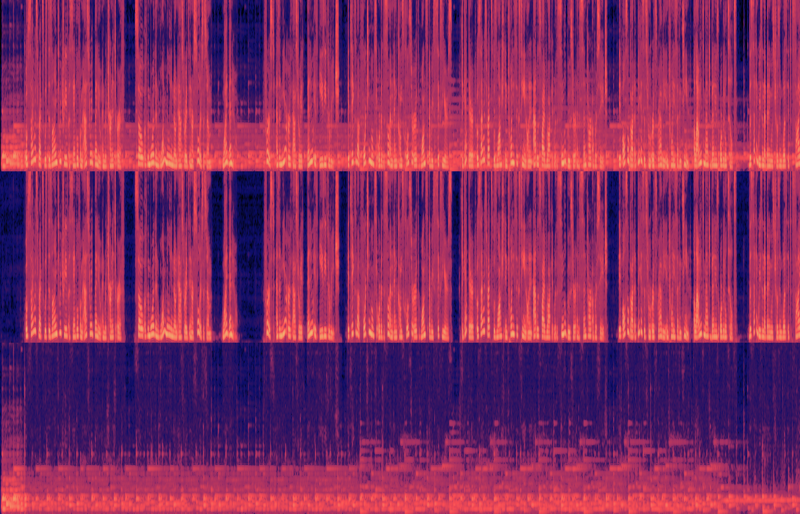

# Music Remover — без музыки

Расширение Chrome, которое убирает фоновую музыку из видео на YouTube и оставляет голос.
По желанию оно также заглушает или запикивает мат (русский и английский).
Есть и приложение для компьютера, которое чистит видео и аудиофайлы: [desktop/README.md](desktop/README.md).
Нейросети (разделение звука UVR MDX-Net «Kim Vocal 2» и распознавание речи Whisper) работают **локально** на видеокарте через WebGPU.
Также расширение умеет **размывать кадры** с обнажённым телом (мужчин и женщин) и, по желанию, кадры, где видна женщина.
Никакие данные никуда не отправляются.

## Установка (1 минута)

1. Соберите расширение (один раз):
   ```bash
   cd ~/Developer/music-remover-extension
   npm install
   npm run fetch-model   # модели: ~64 МБ (музыка) + ~110 МБ (речь, для фильтра мата) + ~13 МБ (размытие)
   npm run build
   ```
2. Откройте `chrome://extensions`, включите **Режим разработчика** (справа вверху).
3. Нажмите **Загрузить распакованное расширение** и выберите папку `~/Developer/music-remover-extension/dist`.
4. Закрепите значок 🎙 на панели и откройте любое видео на YouTube.

Если YouTube был открыт до установки или обновления расширения, обновите вкладку.

## Как пользоваться

- Расширение включено сразу после установки. Переключатель находится во всплывающем окне по значку.
- В левом верхнем углу видео появляется значок:
  - `⏳ Загружаю модель…` — только при первом видео после запуска браузера (или после 3 минут без видео), около 2–3 с;
  - `⏳ Жду звук от YouTube…` — плеер ещё не загрузил звук этого места (обычно сразу после открытия или перемотки);
  - `⏳ Убираю музыку…` — фрагмент под текущей позицией обрабатывается, около 1–1,5 с;
  - `🎙 Без музыки` — играет очищенный звук (значок через пару секунд исчезает);
  - `⚠ … играет оригинал` — расширение не может обработать звук (например, оно обновилось, а вкладка осталась открытой). Чтобы не было тишины, играет оригинальный звук. Обновите страницу.
- **Строгий режим** (по умолчанию): пока чистый звук не готов, играет тишина, музыка не прозвучит ни на секунду.
- **Мягкий режим**: пока чистый звук не готов, играет оригинал.
- Работают перемотка, пауза и ускорение (1.25×, 1.5×, 2×). При ускорении высота голоса сохраняется.
- Громкость и mute YouTube продолжают работать.

### Фильтр мата

Во всплывающем окне, раздел **«Мат»**: *Не фильтровать* (по умолчанию) / *Заглушать* / *Запикивать*.
Переключатель **«Убирать музыку»** можно выключить: тогда звук остаётся оригинальным, только мат вырезается
(и видеокарта не занята разделением). Главный переключатель по-прежнему выключает всё.

- Речь распознаётся нейросетью Whisper base (OpenAI, ONNX-версия onnx-community) прямо на компьютере, по фрагментам
  5,75 с с запасом в 1 с по краям, чтобы слово на стыке фрагментов было слышно целиком.
- Найденные слова проверяются по спискам: русский мат по корням (хуй, пизд-, еб-/ёб- с приставками, бля, мудак,
  пидор, залупа, гандон, шлюха, сука как ругательство…) с защитой от похожих слов (небо, хлеб, требовать, колебаться,
  сукно, бляха, мандарин…), английский (fuck, shit, bitch, cunt, asshole…). Списки — `src/core/profanity.ts`.
- Слово заглушается вместе с запасом ~0,1 с до и ~0,08 с после, края плавные (10 мс), без щелчков.
  Писк — 1 кГц, громкостью как само слово.
- Язык (русский или английский) определяется для каждого фрагмента; если во фрагменте оба языка, он распознаётся дважды.

### Размытие видео

- Включается отдельным переключателем «Размытие видео» во всплывающем окне (по умолчанию включено).
- **Обнажённое тело** (мужчин и женщин) размывается всегда, пока функция включена. Сюда же относится голый торс и живот.
- **«Размывать, когда в кадре женщина»**: размывается кадр, где видно женское лицо.
- **«Размывать, пока кадр не проверен»** (по умолчанию): кадры, которые нейросеть ещё не видела, размыты. Так бывает первые 2–3 с видео и около секунды после перемотки в незагруженное место.
- Размытие начинается за 0,6 с до найденного кадра и держится 1 с после: на смене сцен ничего не проскакивает.
- Значок на видео: `⏳ Проверяю кадры…`, пока кадр не проверен, и `🙈 Скрыто`, когда кадр размыт из-за содержимого.

## Как это работает

```
YouTube player ──appendBuffer──► mse hook (MAIN world) ──► bridge ──Port──► offscreen-документ ──► Worker
     │                                                                                         │
     │ <video> → Web Audio: оригинал заглушён (gain 0)                    демукс WebM/MP4 → WebCodecs
     │                                                                    → ресемпл 44.1 кГц → STFT
     └─ чистый голос ◄── AudioBufferSource, синхронно с currentTime ◄── ONNX (WebGPU) → iSTFT
```

1. **Перехват.** Скрипт в контексте страницы подменяет `SourceBuffer.appendBuffer` и копирует аудио-сегменты в момент, когда плеер YouTube их подгружает, то есть на 20–120 с вперёд.
2. **Обработка** в offscreen-документе расширения, вне страницы (внутри одного Worker на все вкладки: модель грузится один раз). Первым считается фрагмент, который понадобится раньше всех, и играющее видео идёт перед поставленным на паузу:
   - разбор WebM/Opus или fMP4/AAC и декодирование через WebCodecs;
   - нарезка на фрагменты по 5,75 с;
   - нейросеть на WebGPU отделяет голос от музыки.
3. **Воспроизведение.** Оригинальный звук видео заглушается через Web Audio. Очищенные фрагменты встают в расписание ровно под `video.currentTime` с учётом задержки аудиовыхода. Рассинхрон контролируется и исправляется автоматически.

### Как работает размытие

```
YouTube player ──appendBuffer (видео)──► mse hook ──► bridge ──Port 'mr-vis'──► offscreen ──► vision-worker
                                                                                  демукс WebM/MP4 (VP9 / AV1 / H.264)
<video> ◄── CSS filter: blur() ◄── таймлайн «проверено / найдено» ◄────────────  → WebCodecs, каждые 0,25 с кадр:
                                                                                   NudeNet 320 (WebGPU) → нагота + лица
                                                                                   лицо 96×96 → genderage (WASM) → женщина?
```

1. Видеодорожка перехватывается так же, как звук, в момент буферизации, то есть до показа. Пока функция выключена, видео не копируется вообще.
2. Декодируется каждый кадр (иначе нельзя из-за межкадрового сжатия). Но на проверку идут только 4 кадра в секунду: их уменьшенная копия делается на GPU, а остальные кадры сразу освобождаются.
3. **NudeNet** (YOLOv8n, 12 МБ) находит обнажённые части тела и лица. Мужское и женское лицо он не различает, поэтому каждое найденное лицо проверяет **InsightFace genderage** (1,3 МБ, вход 96×96).
4. Страница получает интервалы «проверено» и оценки кадров. Решение «размыть / нет» принимается для каждого кадра по `video.currentTime`. Размытие — CSS-фильтр на элементе `<video>`: его рисует GPU-композитор, страница пиксели не трогает. «Фоновая подсветка» YouTube (ambient mode) на это время скрывается.

## Замеры (MacBook M1 Pro, Chrome)

| Что | Результат |
|---|---|
| Скорость обработки | **~5× быстрее реального времени** (1,16 с на 5,75 с звука) |
| Качество отделения голоса (SDR, тест с известным голосом) | **~21 дБ**, музыка подавлена примерно в 100 раз по мощности |
| Задержка до чистого звука при первом видео | ~4 с (из них ~2,5 с загрузка модели) |
| Задержка на следующих видео / после перемотки | ~1–2 с (модель одна на все вкладки и не перезагружается) |
| Рассинхрон звука и видео | ≤ 25 мс (порог заметности ~45 мс) |
| Проверка на настоящем YouTube | Opus/WebM перехватывается, очищенный звук играет, рассинхрон 17 мс |
| Настоящее видео с дикторским текстом и музыкой (NASA, «Why Did NASA Choose Asteroid Bennu», public domain) | в моменты, где звучит только музыка, она тише на **19,7 дБ** (~в 100 раз); речь сохраняется |

**Размытие:**

| Что | Результат |
|---|---|
| Размер | +13 МБ моделей (NudeNet 12 МБ + genderage 1,3 МБ), +30 КБ кода |
| Скорость проверки | 640×360: **~10× быстрее реального времени**; 1080p VP9: **~6×** |
| Первый проверенный кадр при открытии видео | ~2 с (360p) / ~3 с (1080p), включая загрузку моделей |
| После перемотки в незагруженное место | 0,4–0,9 с (360p) |
| Тестовое видео с известным содержимым (портреты женщин и мужчин крупным планом, пейзажи; `npm run test:blur`) | **160 из 160** проверок совпали: женщины размыты весь отрезок, мужчины и пейзажи — нет |
| Портреты (8 женщин, 7 мужчин, фото) | женщины 0,65–1,00, мужчины 0,00–0,27 при пороге 0,5; одна ошибка (отретушированное фото 1961 г.) |



*Сверху вниз: оригинальный звук, звук после расширения, что было убрано. Горизонтальные полосы — ноты музыки.
В очищенном звуке паузы между фразами тёмные (музыки нет), а вся мелодия ушла в нижнюю дорожку.*

### Фильтр мата: замеры (M1 Pro, `node tests/e2e/profanity.mjs`)

Тестовая запись — 45 с речи голосами macOS (Samantha, Milena) с музыкой; 7 матерных слов (2 на стыках фрагментов)
и 5 похожих приличных слов (dictionary, небо, хлеб, требовать, колебаться).

| | С удалением музыки | Без удаления музыки |
|---|---|---|
| Найдено слов | 6 из 7 | 6 из 7 |
| Ложные срабатывания | 0 | 0 |
| Задето приличной речи | 0 % | 0,1–0,2 % |
| Распознавание, на фрагмент 5,75 с | ~1,1 с | ~1,7 с |
| Вся обработка | 2,5× быстрее реального времени | 3,2× |
| Ошибка границ слова (после поправки) | обычно ±60 мс, до ~160 мс | то же |

Сравнение моделей Whisper (`npm run bench:asr`): tiny — границы слов ошибаются на 0,3–0,5 с; base — ~1,3 с на фрагмент;
small — ~2,9 с на фрагмент, вместе с удалением музыки впритык к реальному времени. Выбрана base.

## Ограничения

- Фильтр мата: пропускает часть слов (на тесте 1 из 7, «хуя» в «какого хуя» после синтезатора речи). На отделённом голосе
  Whisper ошибается чаще, чем на чистой речи, поэтому распознаванию подмешивается 30 % оригинала. Нужна видеокарта
  с fp16 (WebGPU `shader-f16`). Первый чистый звук с фильтром — через 3–8 с (загрузка двух моделей).

- Работает на YouTube (включая встроенные плееры youtube-nocookie). Сервисы с DRM (Netflix и т. п.) не поддерживаются: доступа к их звуку нет.
- Нужен WebGPU (Chrome 116+ на Mac, Windows и ChromeOS). Без него модель идёт на CPU примерно в 10 раз медленнее и будет отставать.
- Песни с вокалом: модель считает пение голосом и оставляет его, убирается только аккомпанемент.
- Если открыть ссылку на видео без единого клика по странице, Chrome может не разрешить звук. Тогда на видео появится подсказка: кликните по странице.
- Модель (~64 МБ) входит в расширение. Во время просмотра нагружается видеокарта. Через 3 минуты бездействия модель выгружается из памяти.
- **Размытие: женщины узнаются по лицу.** Надёжно, когда лицо видно хотя бы средним планом. Женщина издалека (лицо меньше ~5 % высоты кадра), со спины или без видимого лица часто **не распознаётся**. Проверено на трансляции NASA с МКС: две фигуры в полный рост в кадре 1080p, женщина не определилась. Для таких случаев нужна модель побольше (см. ниже).
- Размытие: ложные срабатывания возможны (например, «голый живот» на облегающей форме). Это сделано намеренно: лучше размыть лишнее, чем пропустить.

## Разработка

```bash
npm run build          # сборка в dist/
npm run watch          # пересборка при изменениях
npm test               # юнит-тесты: FFT, STFT/iSTFT, демуксеры, таймлайн, time-stretch
npm run test:separation  # модель на синтетической речи + музыке (Node, CPU)
npm run test:e2e       # полный конвейер в Chromium на локальном YouTube-подобном MSE-плеере
npm run test:blur      # размытие: тестовое видео с известным содержимым (качает фото с Wikimedia Commons)
npx tsx tests/vision-calib.node.ts <папка .rgba>  # оценки моделей по кадрам (Node, CPU) — для подбора порогов
npm run bench          # скорость модели на WebGPU в браузере
npm run bench:asr      # распознавание речи: tiny/base/small (нужно: npm run fetch-asr-model -- --all)
node tests/e2e/make-profanity-media.mjs && node tests/e2e/profanity.mjs   # фильтр мата end-to-end
npm run package        # zip для установки / Chrome Web Store
```

Отладка: на странице YouTube выполните `localStorage.__mr_debug = '1'` и обновите её.
Состояние будет в `window.__musicRemoverDebug.info`.

Структура:

```
src/core/         FFT (смешанные основания), STFT/iSTFT для MDX, ресемплинг, WSOLA, демуксеры WebM/MP4 (звук и видео),
                  nudenet.ts (пред/постобработка моделей размытия), vision-timeline.ts (решение «размыть»)
src/processor/    offscreen-документ + Worker: хранилище пакетов, WebCodecs-декодер, ONNX Runtime (WebGPU);
                  vision-worker.ts — проверка кадров
src/content/      main.ts (MAIN world: хук MSE + плеер + значок), bridge.ts (настройки, связь с процессором, повтор заголовков),
                  blur.ts (размытие), bridge-vision.ts (канал к проверке кадров)
src/popup/        всплывающее окно
static/           manifest.json, html/css
tests/            юнит-тесты и e2e (Playwright)
```

Модели и лицензии (важно перед публикацией в Chrome Web Store):

| Модель | Откуда | Лицензия |
|---|---|---|
| [UVR MDX-Net Kim Vocal 2](https://github.com/TRvlvr/model_repo/releases) | проект Ultimate Vocal Remover | проверьте лицензию весов |
| [NudeNet v3 320n](https://github.com/notAI-tech/NudeNet) | официальный пакет `nudenet` 3.4.2 на PyPI | **AGPL-3.0**: при распространении расширения нужно открыть его исходный код |
| [InsightFace genderage](https://github.com/deepinsight/insightface) | официальный релиз `buffalo_l` (v0.7) | **только некоммерческое использование** (для коммерческого — лицензия InsightFace) |
